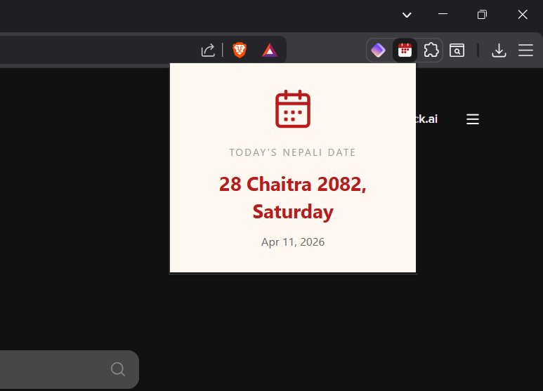

# BS-Extension
A simple extension that shows today's date in BS. Works on Chrome and Firefox.

# How it works
The extension grabs the date from [HamroPatro](https://www.hamropatro.com/) and just displays it in the popup, very simple.

# How to use it
1. Download the files from [here](https://github.com/sam4duh/BS-Extension/archive/refs/heads/main.zip) or clone the repo.

**Chrome / Brave**
1. Go to `chrome://extensions`
2. Turn on developer mode
3. Click "Load unpacked" and select the BS-Extension folder
4. Done.

**Firefox**
1. Go to `about:debugging#/runtime/this-firefox`
2. Click "Load Temporary Add-on..."
3. Pick the `manifest.json` file inside the BS-Extension folder
4. Done. (Temporary add-ons get removed when you close Firefox, so you'll need to load it again next time.)

Shortcut to open the popup is `Alt+Shift+D`. You can change it from `about:addons` > gear icon > "Manage Extension Shortcuts" on Firefox.

If it says it couldn't load the date on Firefox, open `about:addons`, click the extension, go to Permissions and make sure the hamropatro.com access is turned on.

---
*last updated ( UTC ): <!-- last-updated -->October 15, 2026, 05:12 UTC<!-- /last-updated -->*
